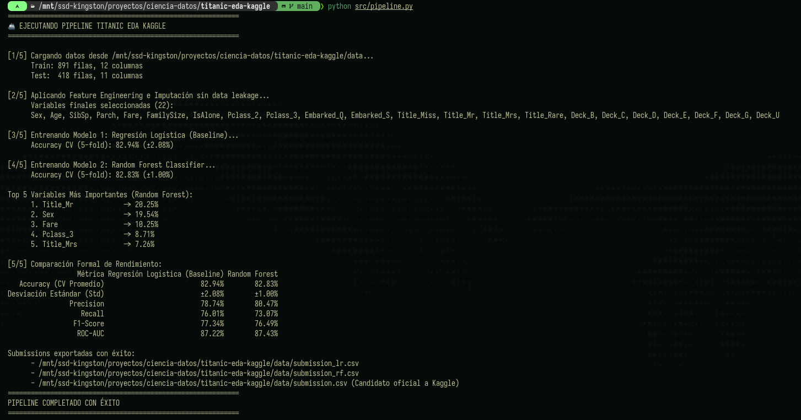

# 🚀 Guía de Ejecución y Reproducibilidad

Este manual describe los pasos exactos para configurar el entorno, ejecutar el pipeline de datos, correr la suite de pruebas unitarias y generar las predicciones para Kaggle.

---

## 1. Requisitos del Sistema

* **Sistema Operativo:** Linux (probado en Arch Linux), macOS o Windows.
* **Python:** 3.10 o superior (recomendado Python 3.11 o 3.12).
* **Gestor de paquetes:** `conda` (Miniconda) o `venv` con `pip`.

---

## 2. Configuración del Entorno Virtual

### Opción A: Usando Conda (Recomendada)
```bash
# Crear entorno con las librerías base
conda create -n ciencia-datos python=3.12 pandas numpy scikit-learn seaborn matplotlib jupyter pytest -y

# Activar el entorno
conda activate ciencia-datos
```

### Opción B: Usando Pip y Virtualenv
```bash
python3 -m venv .venv
source .venv/bin/activate
pip install -r requirements.txt
pip install pytest
```

---

## 3. Descarga y Verificación de Datos

Los datos de la competencia de Kaggle deben ubicarse dentro de la carpeta `data/`:
* `data/train.csv` (891 filas)
* `data/test.csv` (418 filas)
* `data/gender_submission.csv` (ejemplo oficial de Kaggle)

> **Nota:** Estos archivos están ignorados en Git por `.gitignore` respetando las buenas prácticas de almacenamiento y derechos de datos.

---

## 4. Ejecución del Pipeline Automatizado (CLI)

Para ejecutar todo el ciclo (carga $\rightarrow$ feature engineering $\rightarrow$ entrenamiento $\rightarrow$ evaluación $\rightarrow$ exportación de CSVs):

```bash
cd /mnt/ssd-kingston/proyectos/ciencia-datos/titanic-eda-kaggle
python src/pipeline.py
```

### Captura de Salida Real en Terminal:


*(Para un desglose conceptual exhaustivo línea por línea de esta salida, consultar [docs/06_interpretacion_salida_consola.md](06_interpretacion_salida_consola.md). Para el análisis de las fórmulas y fundamentos teóricos, ver [docs/07_fundamentos_matematicos.md](07_fundamentos_matematicos.md)).*

### Salida esperada en consola:
* Mensajes con dimensiones de datos de entrada.
* Lista de 22 variables calculadas tras One-Hot Encoding.
* Métricas de 5-Fold Cross Validation para Regresión Logística y Random Forest.
* Ranking Top 5 de variables más importantes.
* Generación de:
  * `data/submission_lr.csv` (Predicciones con Regresión Logística)
  * `data/submission_rf.csv` (Predicciones con Random Forest)
  * `data/submission.csv` (Candidato oficial listo para subir a Kaggle)

---

## 5. Ejecución del Notebook Interactivo

Para explorar los gráficos de Seaborn y el análisis paso a paso en Jupyter:

```bash
jupyter notebook notebooks/01_eda_titanic.ipynb
```

O si preferís re-ejecutarlo de forma headless desde la terminal:
```bash
jupyter nbconvert --to notebook --execute --inplace notebooks/01_eda_titanic.ipynb
```

---

## 6. Ejecución de la Suite de Pruebas Automatizadas

El proyecto incluye 10 pruebas unitarias con `pytest` que verifican:
* Extracción y normalización de títulos de cortesía (`test_extract_title`).
* Cálculo exacto del tamaño de familia (`test_add_family_size`).
* Bandera binaria de viaje en solitario (`test_add_is_alone`).
* Extracción de cubierta de cabina (`test_extract_deck`).
* Ausencia total de valores nulos post-imputación (`test_impute_missing_values`).
* Compatibilidad estricta de tensores en matrices de entrada (`test_prepare_features`).
* Convergencia y calibración de modelos (`test_train_baseline_logistic_regression`, `test_train_random_forest`).
* Formato estricto de la submission (`test_generate_submission`).

Para correr los tests:
```bash
pytest -v
```

Resultado esperado:
```
============================== 10 passed in ~5s ==============================
```
